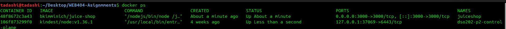
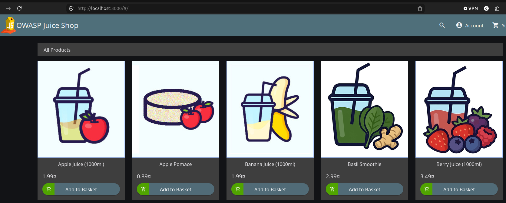
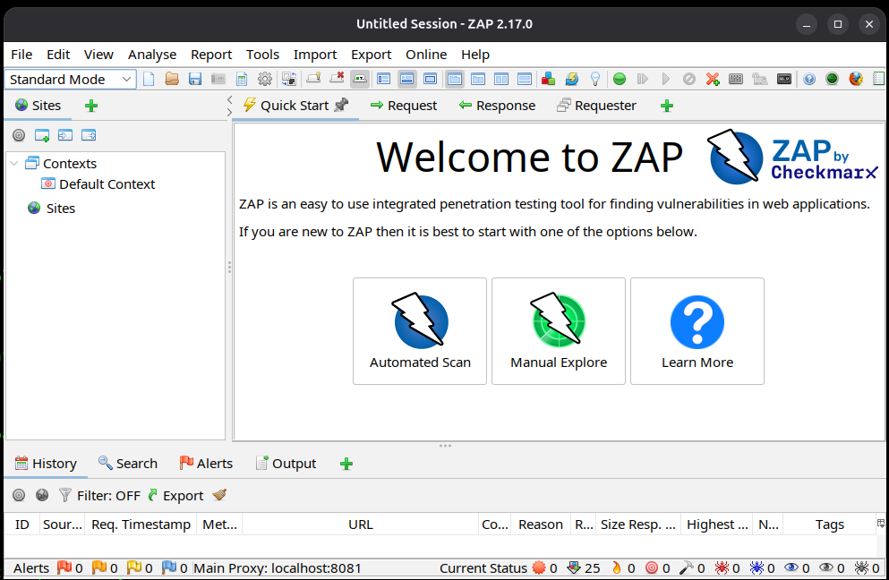
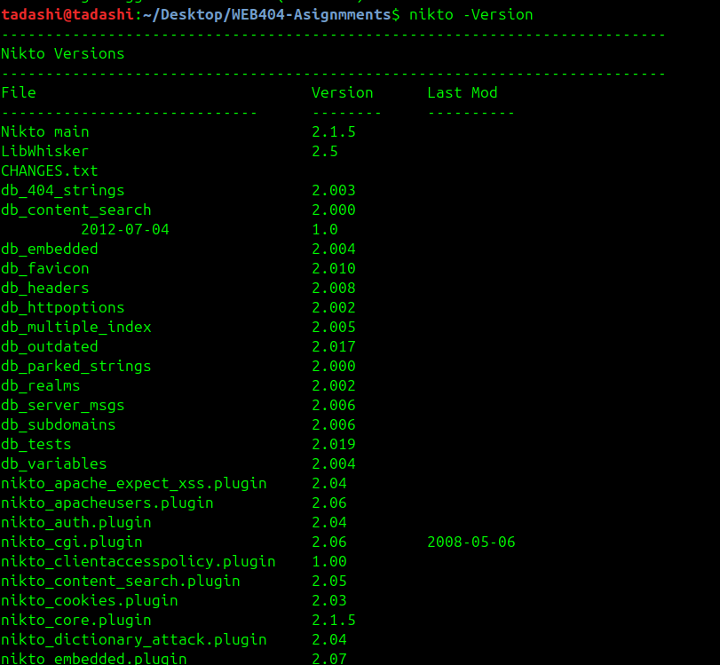
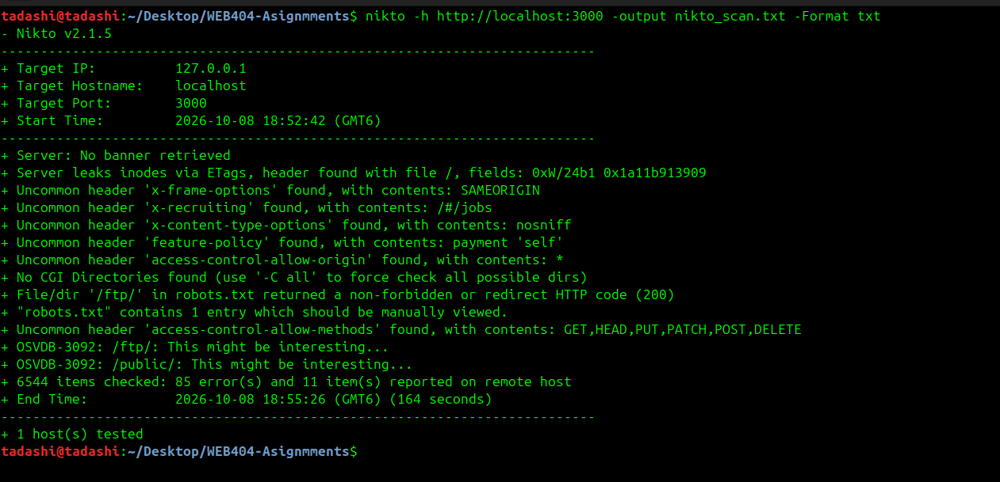
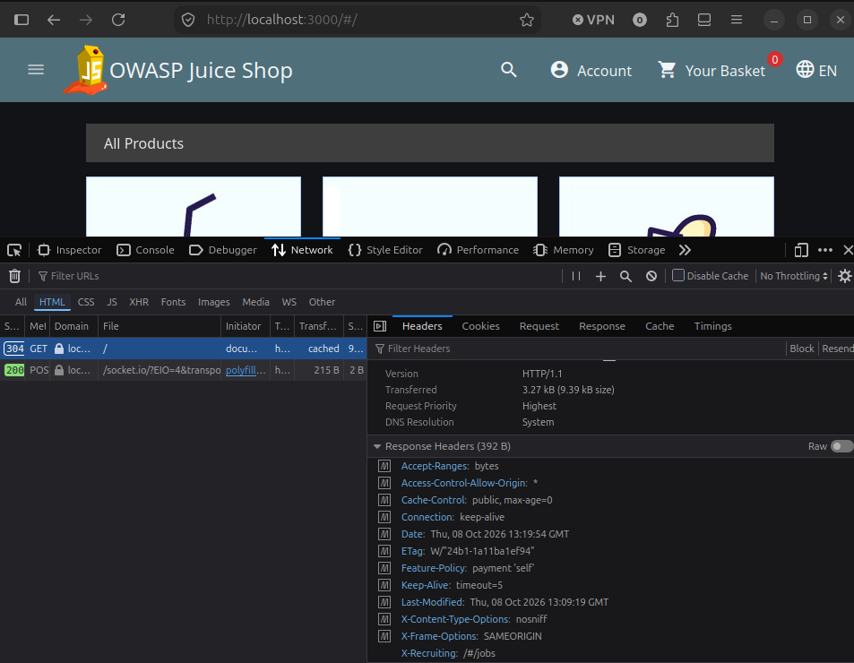
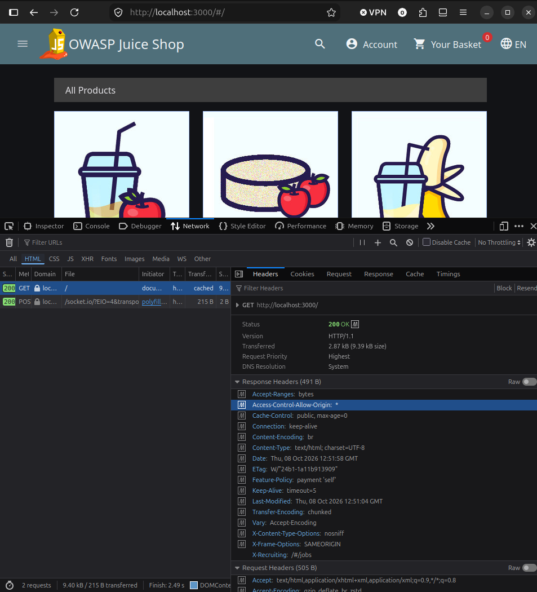
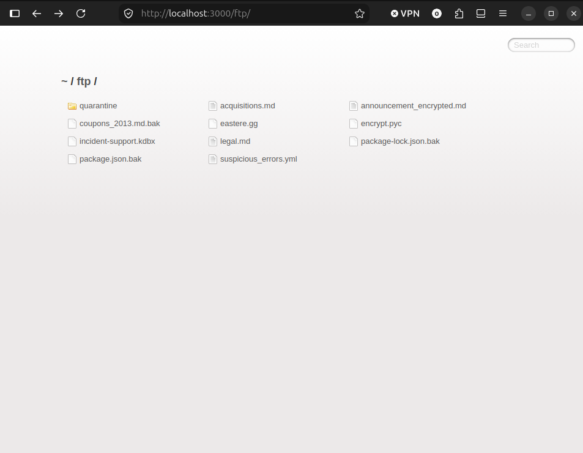
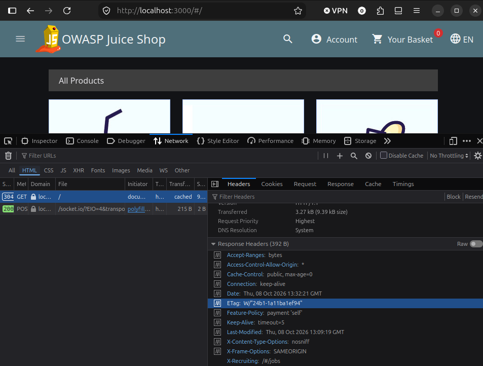

# Assignment 1 — Security Assessment and Remediation Report

## 1. Executive Summary

This report presents the findings of a security assessment conducted against a locally hosted test instance of OWASP Juice Shop running on port 3000. The objective of this lab is to perform passive crawling and automated security scans, evaluate HTTP security headers, eliminate duplicate or false-positive findings, and formulate appropriate remediation strategies.

The primary security weaknesses identified involve missing defense-in-depth HTTP security headers and sensitive technological information disclosure in application HTTP responses.

---

## 2. Methodology & Tooling Setup

- **Environment architecture:** Target endpoint: `http://localhost:3000` (deployed via Docker)


```NOTE
OWASP Juice Shop is a modern, open-source, and intentionally insecure web application that simulates a realistic online e-commerce store
```



- **Proxied listener:** OWASP ZAP intercepting proxy running on `127.0.0.1:8080`

  

- **Nikto:** Web server scanner.



## 3. Technical Execution Steps

### Executed Automated Scan with Nikto



### Findings:

VULN-01: Missing Content-Security-Policy (CSP) (Severity: High). There is no Content-Security-Policy header present



VULN-02: Wildcard CORS Access Control (Access-Control-Allow-Origin: *) (Severity: Medium). The cross-origin requests are unrestricted.



VULN-03: Sensitive Information Disclosure via Public /ftp/ Directory (Severity: Medium). It shows an active directory listing containing sensitive backup and operational files




VULN-04: Information Disclosure via Inode-Based ETag Headers (Severity: Low).The ETag value W/"24b1-1a11ba1ef94" is generated using file metadata (specifically the file size 24b1 in hex and the system inode or exact modification timestamp 1a11ba1ef94 in hex)



---

## 4. Remediation Implementation

The following remediation plan converts the scan findings into practical security controls for the Juice Shop deployment. The controls should be applied in a separate test deployment first so that the original vulnerabilities remain reproducible for assessment evidence. After validation, the same configuration can be promoted to the production deployment.


### 4.2 VULN-03 — Remove the public `/ftp/` directory

**Risk:** The directory listing can expose backups, logs, source files, or operational documents. `robots.txt` is not an access-control mechanism; it only provides instructions to crawlers.

**Implementation steps**

1. Remove the `ftp` directory from the application's public document root.
2. Move required private files to storage outside the container's web root and outside any publicly mounted Docker volume.
3. Search the Docker image, mounted volumes, and build artifacts for duplicate copies of the files.
4. Disable directory indexing at the reverse proxy or web-server layer.
5. Remove the `/ftp/` entry from `robots.txt` after the resource has been removed. Do not rely on this change as the security control.
6. If file downloads are required, expose only an authenticated endpoint that checks authorization for each file and records download activity.

**Nginx implementation**

```nginx
location /ftp/ {
    return 404;
}

autoindex off;
```

If the application uses Express, the directory must not be mounted as static content:

```js
// Do not expose backup or operational files:
// app.use('/ftp', express.static(path.join(__dirname, 'ftp')));
```

**Acceptance tests**

```bash
curl -i http://localhost:3000/ftp/
curl -i http://localhost:3000/robots.txt
```

- `/ftp/` returns `404` or `403`, never `200`.
- No directory index is rendered.
- Known backup or configuration filenames cannot be downloaded.
- Sensitive files are outside the public web root and are absent from the final image.

### 4.3 VULN-02 — Replace wildcard CORS

**Risk:** `Access-Control-Allow-Origin: *` allows any website to make permitted cross-origin requests. This can increase the impact of weaknesses in endpoints that return sensitive data. Wildcard origins must not be used with credentialed requests.

**Implementation steps**

1. Identify the legitimate browser and API origins required by the application.
2. Store those origins in deployment configuration rather than hard-coding development values.
3. Apply CORS only to the routes that require it.
4. Permit only the required methods and headers.
5. Return `Vary: Origin` when the response is generated conditionally for an approved origin.
6. Reject unapproved origins and review all credentialed endpoints separately.

**Express implementation example**

```js
const allowedOrigins = new Set(
  (process.env.CORS_ALLOWED_ORIGINS ?? '')
    .split(',')
    .map((origin) => origin.trim())
    .filter(Boolean)
);

app.use(cors({
  origin(origin, callback) {
    if (!origin || allowedOrigins.has(origin)) {
      return callback(null, true);
    }
    return callback(new Error('CORS origin is not allowed'));
  },
  methods: ['GET', 'POST'],
  allowedHeaders: ['Content-Type', 'Authorization'],
  credentials: true
}));
```

The exact middleware must follow the framework's existing error-handling conventions. The essential control is an exact allowlist, not the specific package.

**Acceptance tests**

```bash
curl -i -H "Origin: https://trusted.example" http://localhost:3000/
curl -i -H "Origin: https://untrusted.example" http://localhost:3000/
```

- An approved origin receives its exact origin value, not `*`.
- An unapproved origin receives no CORS permission.
- Preflight responses contain only required methods and headers.
- Automated tests cover approved, unapproved, absent, and malformed `Origin` headers.

### 4.4 VULN-01 — Implement a Content-Security-Policy

**Risk:** Without CSP, the browser has no additional policy restricting where scripts, styles, frames, images, and connections may be loaded from. CSP reduces the impact of some XSS and unsafe-content scenarios, but it does not replace output encoding, input validation, or secure session handling.

**Implementation approach**

1. Inventory the application's scripts, styles, images, fonts, API connections, workers, and frames.
2. Begin with `Content-Security-Policy-Report-Only` to identify required sources without breaking the application.
3. Remove inline scripts, inline event handlers, and unnecessary third-party sources where possible.
4. Replace `'unsafe-eval'` and `'unsafe-inline'` with nonces or hashes wherever the application permits.
5. Enforce the tested policy with `Content-Security-Policy`.

**Baseline reverse-proxy policy**

```nginx
add_header Content-Security-Policy-Report-Only
    "default-src 'self';
     base-uri 'self';
     object-src 'none';
     frame-ancestors 'self';
     script-src 'self';
     style-src 'self' 'unsafe-inline';
     img-src 'self' data:;
     font-src 'self';
     connect-src 'self';
     form-action 'self'"
    always;
```

The policy must be adjusted to the application's verified resource requirements. It should not be copied into enforcement mode until browser testing confirms that legitimate functionality still works.

**Acceptance tests**

```bash
curl -sSI http://localhost:3000/ | grep -i content-security-policy
```

- Every relevant HTML response includes a CSP header.
- Browser functionality works without unexpected CSP violations.
- Report-only violations are reviewed and unnecessary sources are removed.
- The final enforced policy does not contain broad sources such as `*` or unreviewed third-party domains.

### 4.5 VULN-04 — Remove inode-based ETag disclosure

**Risk:** The observed ETag contains file metadata such as size and an inode or modification value. This is a low-severity information disclosure, but it unnecessarily reveals server implementation details.

**Implementation options**

Use one consistent option across the deployment:

```nginx
# Disable ETags at the reverse proxy.
etag off;
```

Alternatively, configure the application framework to disable ETags. If caching requires validators, use a strong application-generated version or hash that does not expose filesystem metadata. Disabling ETags may increase conditional-request traffic, so cache-control headers should be reviewed at the same time.

**Acceptance tests**

```bash
curl -sSI http://localhost:3000/ | grep -i etag
```

- The response does not contain an ETag, or it contains a value generated independently of inode and filesystem metadata.
- Cache behavior remains acceptable after the change.
- A scan of representative static and dynamic responses confirms that the old metadata format is absent.

### 4.6 Regression verification and completion criteria

After implementing all controls, repeat the Nikto and OWASP ZAP scans against the hardened test deployment and compare the results with the original evidence. The remediation is complete when:

1. `/ftp/` and equivalent sensitive paths are inaccessible and are not indexed.
2. Wildcard CORS is absent and only approved origins are allowed.
3. CSP is present, tested, and enforced for the relevant application responses.
4. Inode-based ETags are absent or replaced with safe validators.
5. No new high-severity findings are introduced by the proxy or application changes.
6. The configuration and automated tests are included in the deployment process so the fixes cannot silently regress.

The original scan findings should be retained as before-remediation evidence, while a new scan report should be attached as after-remediation evidence.
