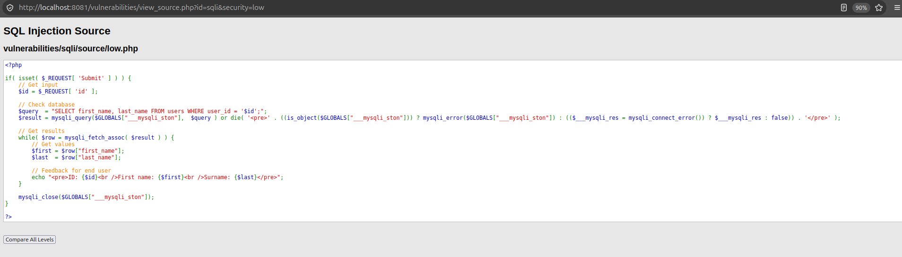
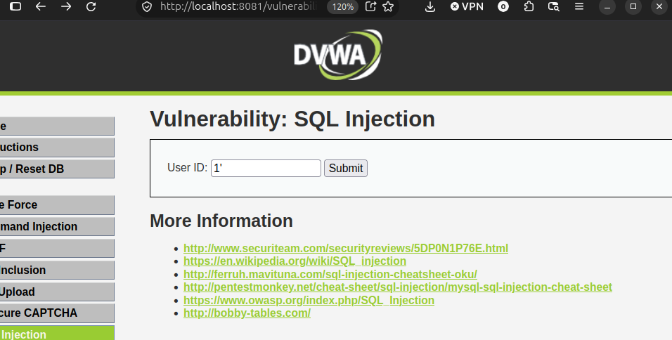
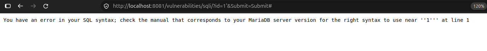
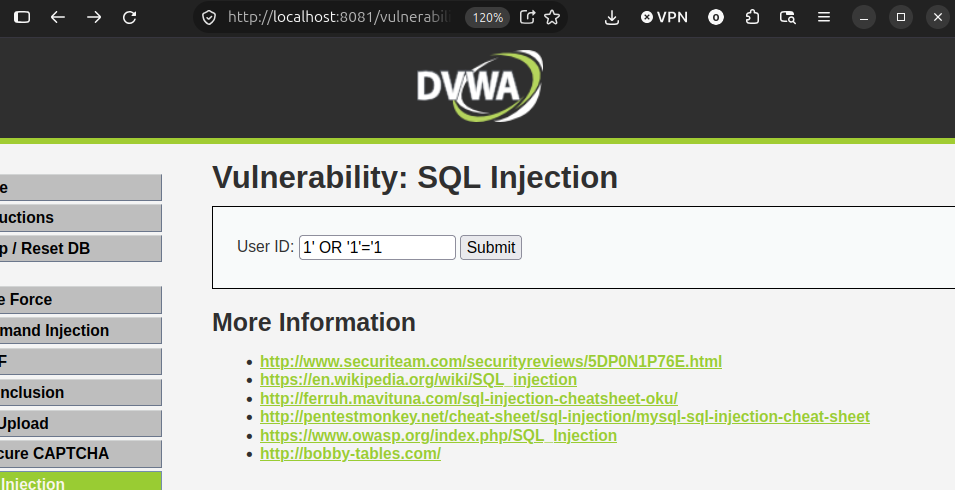
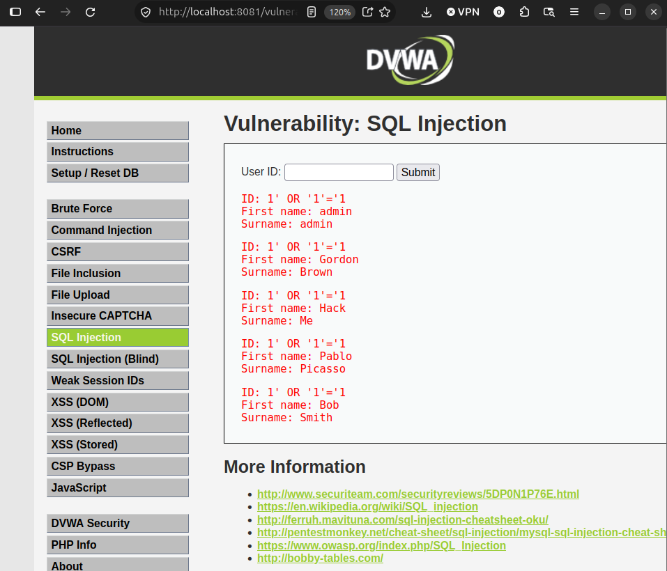
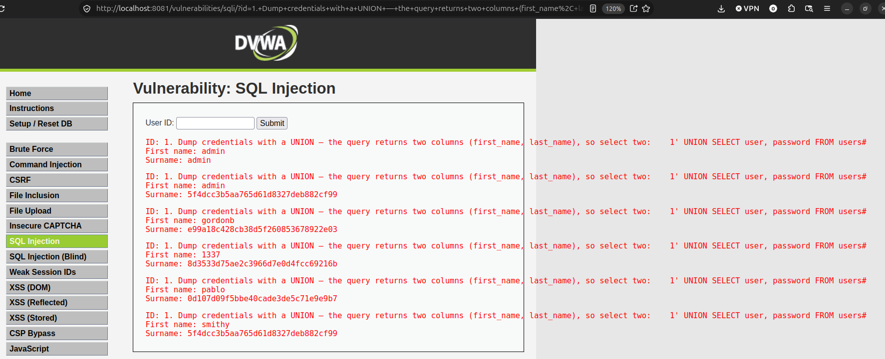
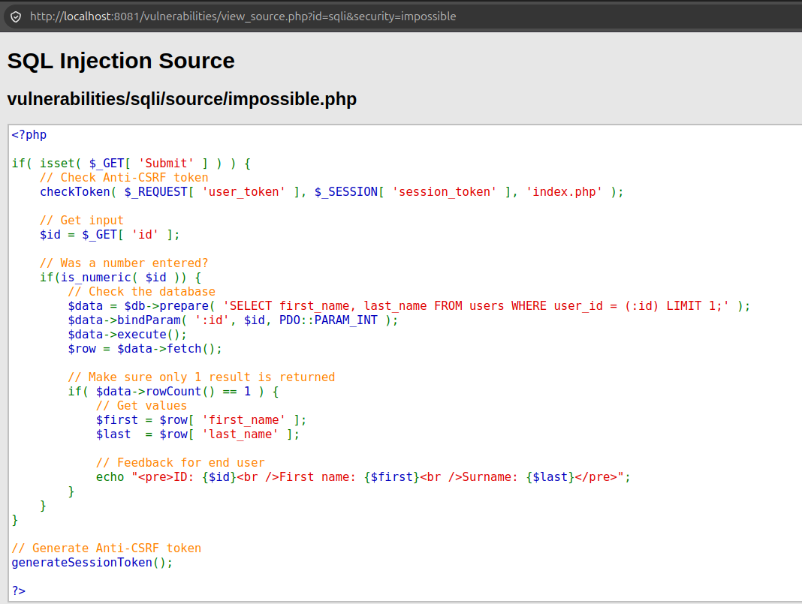
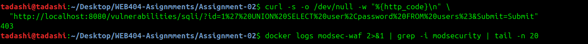
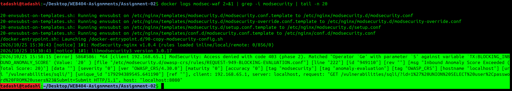

# Assignment 2 Report SQL Injection & WAF Protection (DVWA)

## Introduction & objectives

This report documents the identification, exploitation, and remediation of a SQL injection (SQLi) vulnerability in DVWA (Damn Vulnerable Web Application), a PHP/MySQL application built for security practice. The flaw in DVWA's SQL Injection module is analysed, then defended at two layers: a code-level fix using a parameterized query, and a network-level control using a ModSecurity web application firewall with the OWASP Core Rule Set (CRS).

DVWA implements the same feature at several security levels. The Low level is the vulnerable concatenated query, and the Impossible level is the parameterized (PDO prepared statement) version, so the before/after source in this report is taken directly from the application.

Objectives:
- Inspect and explain the vulnerable database query (OWASP A03: Injection).
- Demonstrate a SQL injection that extracts data from the database.
- Remediate the flaw using a parameterized query.
- Deploy a WAF that detects and blocks the same attack.
- Verify that both controls work and that legitimate requests are unaffected.

### Inspected the vulnerable code

Why it is injectable:
- $id comes straight from the HTTP request and is inserted into the query as text, inside single quotes, with no escaping or binding — so input is parsed as SQL, not just data.
- There is no type check and no parameter binding, so a crafted id can add conditions, a UNION, or a comment and rewrite the query.
- Classification: OWASP A03:2021 — Injection (CWE-89).

```php
<?php

if( isset( $_REQUEST[ 'Submit' ] ) ) {
    // Get input
    $id = $_REQUEST[ 'id' ];

    // Check database
    $query  = "SELECT first_name, last_name FROM users WHERE user_id = '$id';";
    $result = mysqli_query($GLOBALS["___mysqli_ston"],  $query ) or die( '<pre>' . ((is_object($GLOBALS["___mysqli_ston"])) ? mysqli_error($GLOBALS["___mysqli_ston"]) : (($___mysqli_res = mysqli_connect_error()) ? $___mysqli_res : false)) . '</pre>' );

    // Get results
    while( $row = mysqli_fetch_assoc( $result ) ) {
        // Get values
        $first = $row["first_name"];
        $last  = $row["last_name"];

        // Feedback for end user
        echo "<pre>ID: {$id}<br />First name: {$first}<br />Surname: {$last}</pre>";
    }

    mysqli_close($GLOBALS["___mysqli_ston"]);
}

?>
```


### Step 3 — Exploit the SQL injection

In the User ID box (security = Low), work up from a probe to a full credential dump. Enter each and submit.

1. Confirm the injection point — a single quote breaks the query:





2. Return every row — make the condition always true:





3. Dump credentials with a UNION, the query returns two columns (first_name, last_name)

```sql
1' UNION SELECT user, password FROM users#
```


## Remediation A: parameterized query

Before — Low (vulnerable, concatenated):

 (prepared statement) 

After — Impossible (secure, parameterized):



### Fixed code: 
- :id is a placeholder; bindParam() sends the user value separately as a typed (integer) parameter, so the database compares it as data and never parses it as SQL. As a result, 1' UNION SELECT ... is not executed and no data is returned.

when rerunning the attack the same payload that worked fails after fixing the code. 

### Step 5 — Remediation B: WAF (ModSecurity + OWASP CRS)

#### WAF configuration (docker-compose.yml):

```yaml
services:
  dvwa:
    image: vulnerables/web-dvwa
    container_name: dvwa
    ports:
      - "8081:80"
  waf:
    image: owasp/modsecurity-crs:nginx
    container_name: modsec-waf
    depends_on:
      - dvwa
    ports:
      - "8080:8080"
    environment:
      BACKEND: "http://dvwa:80"
      PORT: "8080"
      MODSEC_RULE_ENGINE: "On"
      PARANOIA: "1"
      ANOMALY_INBOUND: "5"
      MODSEC_AUDIT_ENGINE: "RelevantOnly"
      MODSEC_AUDIT_LOG: "/var/log/modsec/audit.log"
      MODSEC_AUDIT_LOG_FORMAT: "JSON"
    volumes:
      - ./waf-logs:/var/log/modsec
```

How CRS decides to block:
- Each request is checked against the OWASP Core Rule Set; the SQL-injection family is rule group 942xxx (rule 942100 uses libinjection).
- In anomaly-scoring mode, matched rules add to an inbound score; when it reaches the threshold (ANOMALY_INBOUND=5), rule 949110 returns 403 Forbidden.

When passing the injection through the WAF the CRS inspects the query string and the request is blocked. The payload gets WAF's 403 page instead of the data.

```bash 
curl -s -o /dev/null -w "%{http_code}\n" \ "http://localhost:8080/vulnerabilities/sqli id=1%27%20UNION%20SELECT%20user%2Cpassword%20FROM%20users%23&Submit=Submit"
```


The prove can be seen in the captured WAF logs. 



### How parameterized queries prevent SQL injection

SQL injection occurs because a concatenated query combines program code (the SQL command) and user data into a single string so the database cannot distinguish the two and parses injected characters such as ' OR '1'='1 or UNION SELECT ... as SQL.

A parameterized query separates them:
1. The SQL template with a placeholder (:id, ?) is sent to the database first and is parsed, compiled, and planned while the placeholder is empty — fixing the statement structure.
   
2. The user value is sent separately and bound to the placeholder as a typed parameter — bindParam(':id', $id, PDO::PARAM_INT).

3. Because parsing is already complete, the bound value cannot alter the statement structure; it is handled only as data.

Consequently, a payload like 1' UNION SELECT ... is compared as a literal value and no injection occurs. This defeats injection structurally rather than by filtering characters, which is why it is the primary recommended control. Input validation and escaping are useful secondary layers, and a WAF is an outer layer; together they form defense in depth.

