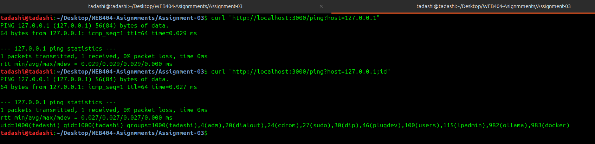
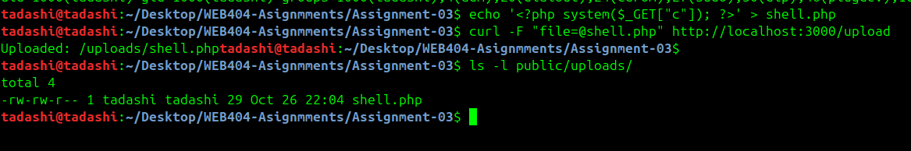
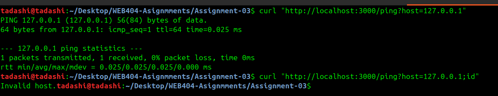
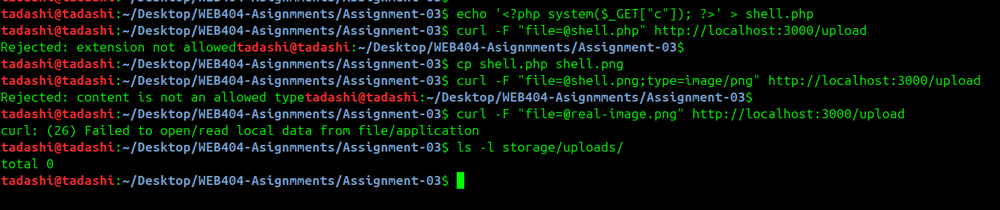

# WEB404 Assignment 3 — Input Validation, File Upload & Command Execution Defenses

### Introduction & objectives

This report documents a small Node.js/Express application containing two common vulnerability classes OS command injection and insecure file upload and their remediation with layered defenses.

The lab was carried out vulnerable-first to test the built in its vulnerable form (app.vulnerable.js) and the attacks were demonstrated succeeding, then the same file was patched to the secure form (app.js) and the identical payloads were re-run to confirm they are now blocked. This gives a direct before/after comparison on the same endpoints.

#### Objectives:

- Replace shell-invoking command execution with a fixed binary and array arguments, guarded by a strict input allowlist.
- Build a file-upload handler with extension allowlisting, MIME and magic-byte validation, UUID renaming, storage outside the web root, and non-executable permissions.
- Document the multi-layer security model applied to the upload pipeline.

### Command injection

A ```ping``` endpoint built with exec() passes its argument through a shell, so shell metacharacters are interpreted as commands.

```js
// VULNERABLE — exec() invokes a shell on a concatenated string
const { exec } = require('child_process');

app.get('/ping', (req, res) => {
  const host = req.query.host;
  exec(`ping -c 1 ${host}`, (err, stdout, stderr) => {
    res.type('text/plain').send(stdout || stderr || String(err));
  });
});
```

The host value is concatenated directly into a command string that is then run by a shell. Any shell separator lets an attacker append their own command, which executes with the privileges of the web process — this is OS command injection (CWE-78).

#### Expliotation
```bash
curl "http://localhost:3000/ping?host=127.0.0.1"              
curl "http://localhost:3000/ping?host=127.0.0.1;id"  
```



The response showing the id output (username / uid) after the ping, confirming command injection on the vulnerable version.

### Why each is unsafe:
- /ping concatenates host into a command string run by a shell, so shell metacharacters (;, &&, |, backticks) execute as separate commands — OS command injection (CWE-78).
- /upload keeps the client-supplied filename and stores the file in the served public/ directory, so an uploaded shell.php / evil.exe lands at a predictable, web-reachable path — unrestricted file upload (CWE-434).

#### Malicious upload a script is accepted and stored in the web root:

This handler keeps the attacker supplied filename and stores the file inside the served web root.

```js
// VULNERABLE
const multer = require('multer');
const vulnStorage = multer.diskStorage({
  destination: 'public/uploads/',
  filename: (req, file, cb) => cb(null, file.originalname) // attacker controls name + extension
});
const uploadVuln = multer({ storage: vulnStorage });

app.post('/upload', uploadVuln.single('file'), (req, res) => {
  res.send('Uploaded: /uploads/' + req.file.originalname);
});
```

**Risk:** an attacker uploads `shell.php`, `backdoor.sh`, or `evil.exe`. Because the file lands in a web-served directory under its own name, on a PHP-capable server it can be requested and executed (remote code execution); even on Node it enables stored XSS, malware hosting, and path traversal via crafted filenames (CWE-434).

### Exploitation

```bash
echo '<?php system($_GET["c"]); ?>' > shell.php
curl -F "file=@shell.php" http://localhost:3000/upload   # Uploaded: /uploads/shell.php
ls -l public/uploads/                                    # shell.php sitting in the served folder
```


The upload response and the `ls` listing showing `shell.php` stored in `public/uploads/` on the vulnerable version.

### Remediation for command injection

The fix uses `execFile()` (which does **not** spawn a shell), passes arguments as an **array** to a fixed binary, and validates the input against a strict **allowlist** before running anything.

```js
// app.js — SECURE
const { execFile } = require('child_process');
const net = require('net');

app.get('/ping', (req, res) => {
  const host = String(req.query.host || '');

  // Strict allowlist: accept only a valid IP address
  if (net.isIP(host) === 0) {
    return res.status(400).type('text/plain')
              .send('Invalid host: provide a valid IPv4/IPv6 address.');
  }

  // No shell is spawned; args go to the ping binary as an array.
  // "--" stops option parsing so input can't become a flag.
  execFile('ping', ['-c', '1', '--', host], { timeout: 5000 },
    (err, stdout, stderr) => {
      res.type('text/plain').send(stdout || stderr || 'ping failed');
    });
});
```

Why it is safe:

- **No shell** — `execFile` runs the binary directly, so `;`, `&&`, `|`, and backticks carry no special meaning.
- **Array arguments** — the host value cannot break out into a new command or flag.
- **Strict allowlist** — `net.isIP()` returns `0` for anything that is not a valid IP, so malformed input is rejected before execution.
- **Timeout** — bounds abuse and hung processes.



the same injection payload now returning `Invalid host.` on the secure version, while a valid IP still returns ping output.

### Remediation for file upload

The secure handler layers independent defenses: size limit → extension allowlist → declared-MIME allowlist → magic-byte content check → UUID rename → store outside the web root → strip the execute permission.

```js
// app.js — SECURE upload handler
const crypto = require('crypto');
const path   = require('path');
const fs     = require('fs');

const UPLOAD_DIR = path.join(__dirname, 'storage', 'uploads'); // OUTSIDE public/
const TMP_DIR    = path.join(__dirname, 'storage', 'tmp');
fs.mkdirSync(UPLOAD_DIR, { recursive: true });
fs.mkdirSync(TMP_DIR, { recursive: true });

const ALLOWED_EXT  = new Set(['.png', '.jpg', '.jpeg', '.pdf']);
const ALLOWED_MIME = new Set(['image/png', 'image/jpeg', 'application/pdf']);

const upload = multer({
  dest: TMP_DIR,
  limits: { fileSize: 5 * 1024 * 1024, files: 1 }   // Layer 1: 5 MB cap, one file
});

// Layer 4: verify the REAL type from magic bytes (never trust extension/MIME)
async function sniffType(filePath) {
  const fd = await fs.promises.open(filePath, 'r');
  const { buffer } = await fd.read({ buffer: Buffer.alloc(8), position: 0 });
  await fd.close();
  if (buffer.slice(0, 8).equals(Buffer.from([0x89,0x50,0x4e,0x47,0x0d,0x0a,0x1a,0x0a])))
    return { ext: 'png', mime: 'image/png' };
  if (buffer[0] === 0xFF && buffer[1] === 0xD8 && buffer[2] === 0xFF)
    return { ext: 'jpg', mime: 'image/jpeg' };
  if (buffer.slice(0, 4).toString() === '%PDF')
    return { ext: 'pdf', mime: 'application/pdf' };
  return null;
}

app.post('/upload', upload.single('file'), async (req, res) => {
  if (!req.file) return res.status(400).send('No file');
  const tmpPath = req.file.path;
  try {
    const ext = path.extname(req.file.originalname).toLowerCase();
    if (!ALLOWED_EXT.has(ext))                 throw new Error('extension not allowed');      // Layer 2
    if (!ALLOWED_MIME.has(req.file.mimetype))  throw new Error('declared type not allowed');  // Layer 3

    const real = await sniffType(tmpPath);                                                    // Layer 4
    if (!real || !ALLOWED_MIME.has(real.mime)) throw new Error('content is not an allowed type');

    const safeName = crypto.randomUUID() + '.' + real.ext;                                    // Layer 5: UUID rename
    const destPath = path.join(UPLOAD_DIR, safeName);                                         // Layer 6: outside web root
    await fs.promises.rename(tmpPath, destPath);
    await fs.promises.chmod(destPath, 0o640);                                                 // Layer 7: no execute bit

    res.send('Stored safely as ' + safeName);
  } catch (e) {
    fs.promises.unlink(tmpPath).catch(() => {});   // always clean up the temp file
    res.status(400).send('Rejected: ' + e.message);
  }
});
```

Stored files are never reachable by URL because `storage/` sits outside `public/`.



The two rejected malicious uploads (extension and magic-byte), the accepted real image stored under a UUID name, and an `ls -l storage/uploads/` listing showing the UUID filename and `0640` permissions.

## Conclusion

Both vulnerabilities were remediated at the source level. Command injection was eliminated by removing the shell entirely (`execFile` with array arguments) and validating input against a strict allowlist. Insecure upload was addressed with a seven-layer pipeline that validates the file by content rather than by its name, renames it, and stores it outside the web root with no execute permission. Running the identical payloads against the vulnerable and secure builds showed the attacks succeeding before the fix and being rejected after it. The approach follows defense in depth: no single check is trusted, input is validated against allowlists rather than blocklists, and user-supplied data is never allowed to determine program structure or execution.