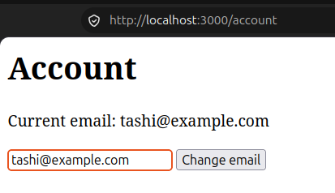
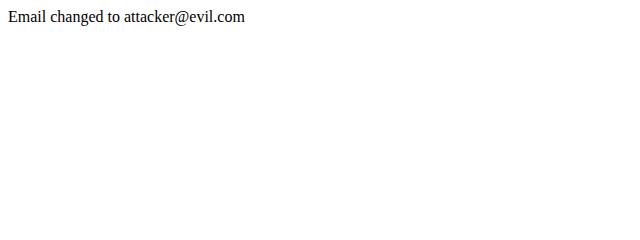
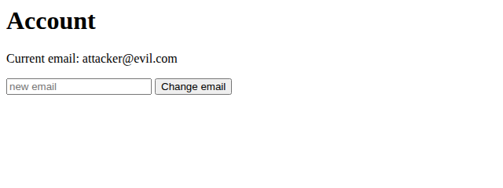
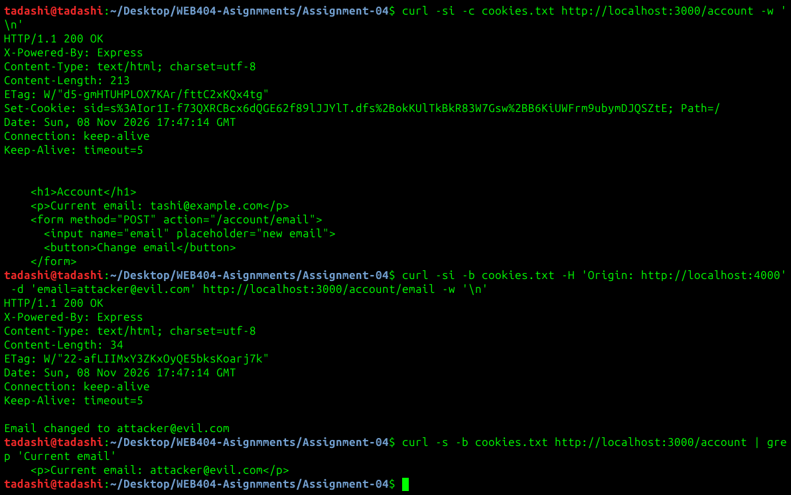
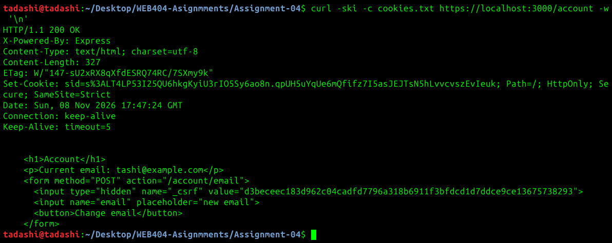
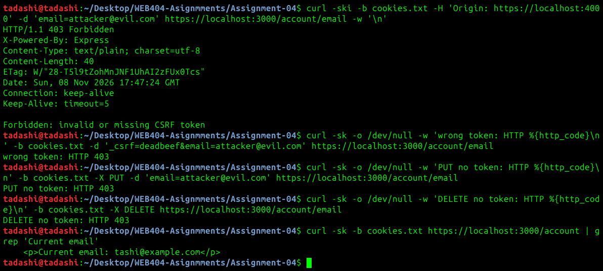
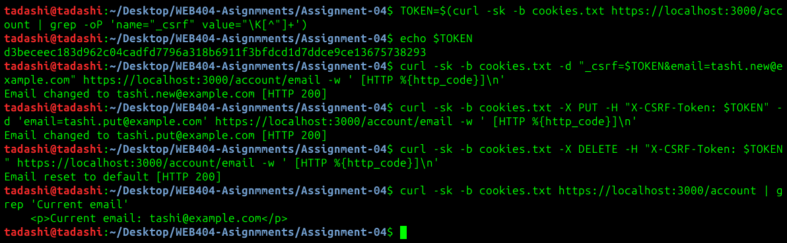
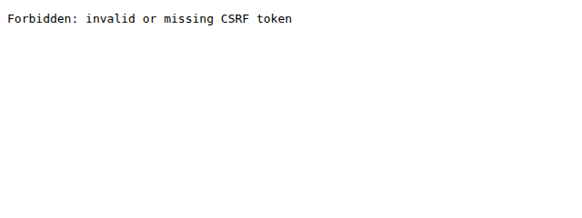
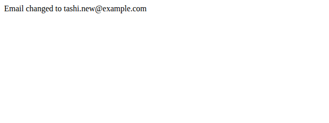
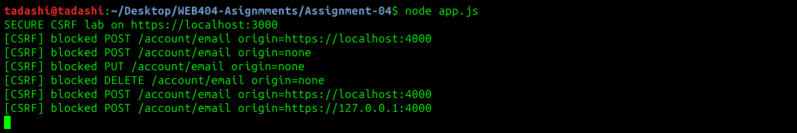

## WEB404 Assignment 4 — Client-Side Vulnerabilities & CSRF Mitigation

### Introduction

This report documents a Cross-Site Request Forgery (CSRF) vulnerability in a small Express application and its remediation. CSRF tricks a victim's browser into sending a state-changing request (here, changing the account email) to a site where they are already logged in. Because the browser attaches the session cookie automatically, the server cannot distinguish the forged request from a genuine one unless it requires a value the attacker's page cannot supply.

The lab was carried out vulnerable-first: the application was built in its vulnerable form (app.vulnerable.js) and the forged request was shown to succeed, then the same file was patched to the secure form (app.js) and the identical request was re-run to confirm it is now rejected with HTTP 403.

A session-based Express app was used (rather than Juice Shop/DVWA) because classic CSRF is a cookie-session problem: applications that authenticate with a bearer token in an Authorization header are not CSRF-able in the same way, since the browser does not attach that token automatically. The brief specifies "Express.js with session handling," which is this lab.

#### Objectives:

- Demonstrate a CSRF attack against a state-changing endpoint.
- Implement an anti-CSRF token using the Synchronizer Token Pattern, verified on all non-idempotent methods.
- Harden the session cookie with HttpOnly, Secure, and SameSite.
- Verify that a cross-site POST lacking a valid token is rejected with HTTP 403.

### How CSRF works

A CSRF attack abuses the fact that browsers send a site's cookies on every request to that site, including requests triggered by a different, malicious site.

The victim logs into the app; the browser holds a session cookie for it.
The victim visits an attacker-controlled page.
That page silently submits a form to the app's state-changing endpoint (POST /account/email).
The browser attaches the app's session cookie automatically.
If the app trusts the cookie alone, it performs the action — the email changes without the victim's knowledge.

The request is "forged" because the attacker never sees the response or the cookie value; they only cause the browser to send a request. The defense is to require a per-session token the attacker's page cannot read, and to stop the browser attaching the cookie cross-site.

### The vulnerability

The state-changing endpoint trusts the session cookie with no token check, and the session cookie has no hardening flags.

```js
// app.vulnerable.js — VULNERABLE
app.use(session({
  name: 'sid',
  secret: crypto.randomBytes(32).toString('hex'),
  resave: false,
  saveUninitialized: true,
  cookie: { httpOnly: false } // HttpOnly disabled, no SameSite, no Secure
}));

app.get('/account', (req, res) => {
  res.type('html').send(`
    <p>Current email: ${esc(req.session.user.email)}</p>
    <form method="POST" action="/account/email">
      <input name="email" placeholder="new email">
      <button>Change email</button>
    </form>`);
});

app.post('/account/email', (req, res) => {   // no verification
  req.session.user.email = req.body.email;
  res.send('Email changed to ' + esc(req.body.email));
});
```

The attacker's page (attacker.html), served from a different origin, auto-submits a hidden form

```html
<body onload="document.forms[0].submit()">
  <form action="http://localhost:3000/account/email" method="POST">
    <input type="hidden" name="email" value="attacker@evil.com">
  </form>
</body>
```
Classification: CWE-352 — Cross-Site Request Forgery.

## Exploitation

Browse with a logged-in session at http://localhost:3000/account, opening http://localhost:4000/attacker.html auto-submits the form and when returning to the account page. The email changed to attacker@evil.com.

The account before the attack:



Opening the attacker page in the browser submits the forged form, and the application accepts it:



Returning to `/account` confirms the change was stored in the victim's session:



The same attack from the terminal shows why it works. The `Set-Cookie` header has only `Path=/`, with no `HttpOnly`, `Secure`, or `SameSite` attribute. The forged POST carries the session cookie and a foreign `Origin`, has no token, and still returns `200 OK`.



## Remediation

The secure build in `app.js` applies two independent defenses. The token check stops forged requests even when the cookie is sent, and the cookie attributes stop the browser sending the cookie cross-site at all.

### Synchronizer Token Pattern

Each session gets a token from 32 bytes of cryptographically secure random data. The token is stored on the server in the session and embedded in the form as a hidden field. An attacker's page can make the browser send a request, but the same-origin policy stops it reading the response that contains the token.

```js
// app.js — SECURE
function getCsrfToken(req) {
  if (!req.session.csrfToken) {
    req.session.csrfToken = crypto.randomBytes(32).toString('hex');
  }
  return req.session.csrfToken;
}

function tokensMatch(sent, expected) {
  if (typeof sent !== 'string' || typeof expected !== 'string') return false;
  const a = Buffer.from(sent);
  const b = Buffer.from(expected);
  return a.length === b.length && crypto.timingSafeEqual(a, b);
}

const SAFE_METHODS = new Set(['GET', 'HEAD', 'OPTIONS']);

function verifyCsrf(req, res, next) {
  if (SAFE_METHODS.has(req.method)) return next();

  const sent = req.body?._csrf ?? req.get('x-csrf-token');
  if (tokensMatch(sent, req.session.csrfToken)) return next();

  console.warn(`[CSRF] blocked ${req.method} ${req.originalUrl} origin=${req.get('origin') || 'none'}`);
  res.status(403).type('text').send('Forbidden: invalid or missing CSRF token');
}

app.use(verifyCsrf);
```

The middleware runs before every route, so POST, PUT, DELETE, and PATCH are all checked and a new route cannot be left out by accident. The token is accepted from the `_csrf` form field or the `X-CSRF-Token` header. `crypto.timingSafeEqual` compares the values in constant time, so response timing does not reveal how much of a guess was correct.

The form carries the token as a hidden field:

```js
<form method="POST" action="/account/email">
  <input type="hidden" name="_csrf" value="${esc(getCsrfToken(req))}">
  <input name="email" placeholder="new email">
  <button>Change email</button>
</form>
```

### Session cookie hardening

```js
cookie: {
  httpOnly: true,       // page scripts cannot read the cookie
  secure: true,         // only sent over HTTPS
  sameSite: 'strict'    // not attached to cross-site requests
}
```

`express-session` will not issue a `Secure` cookie over plain HTTP, so the secure build runs on HTTPS with a local self-signed certificate. The certificate and key are generated locally and excluded from version control:

```bash
mkdir -p certs
openssl req -x509 -newkey rsa:2048 -nodes -keyout certs/localhost.key -out certs/localhost.crt \
  -days 365 -subj /CN=localhost -addext "subjectAltName=DNS:localhost,IP:127.0.0.1"
```

## Verification

The same attacks were re-run against the secure build, started with `node app.js` and `node attacker-server.js --https`.

### Cookie attributes and embedded token

`Set-Cookie` now includes `HttpOnly; Secure; SameSite=Strict`, and the form contains a 64-character hexadecimal token.



### Forged requests are rejected

A forged POST carrying a valid session cookie but no token returns `403 Forbidden`. A wrong token, a PUT with no token, and a DELETE with no token also return 403, and the email is unchanged.



### Legitimate requests still work

With the session's token, POST (form field), PUT, and DELETE (header) all return 200.



### Browser attacks

The attacker page was opened in Chrome from two origins. The Chrome network record below was captured through the DevTools Protocol.

| Attacker origin | Relationship to the app | Session cookie | Result |
|---|---|---|---|
| `https://localhost:4000` | Same site, different port | Sent | 403: stopped by the token check |
| `https://127.0.0.1:4000` | Cross-site | Withheld by `SameSite=Strict` | 403: no session cookie and no token |

```json
{"method":"POST","url":"https://localhost:3000/account/email","origin":"https://localhost:4000","cookies":[{"name":"sid","blocked":[]}],"status":403}
{"method":"POST","url":"https://localhost:3000/account/email","origin":"https://127.0.0.1:4000","status":403,"cookies":[{"name":"sid","blocked":["SchemefulSameSiteStrict"]}]}
```

The first row matters because `SameSite` treats different ports on the same host as the same site, so the token is what stops that attack. The two defenses cover different cases.



After both attacks, the account still shows the original email:


Submitting the real form in the same browser session still succeeds:



The server logged every rejected request:



## Results

| Test | Vulnerable build | Secure build |
|---|---|---|
| Forged POST with session cookie, no token | 200, email changed | 403, email unchanged |
| POST with wrong token | Not applicable | 403 |
| PUT with no token | Route not present | 403 |
| DELETE with no token | Route not present | 403 |
| POST, PUT, DELETE with valid token | Not applicable | 200 |
| Session cookie attributes | `Path=/` only | `HttpOnly; Secure; SameSite=Strict` |

## Conclusion

The CSRF vulnerability was remediated by requiring a per-session Synchronizer Token on every non-idempotent request and by hardening the session cookie with `HttpOnly`, `Secure`, and `SameSite=Strict`. Running the identical forged request against both builds showed it succeeding before the fix and being rejected with HTTP 403 after it, while legitimate requests carrying the token continued to work. The two controls provide defense in depth: `SameSite` stops the browser attaching the cookie to cross-site requests, and the token protects the endpoint in cases `SameSite` does not cover, such as requests from another port on the same host.

