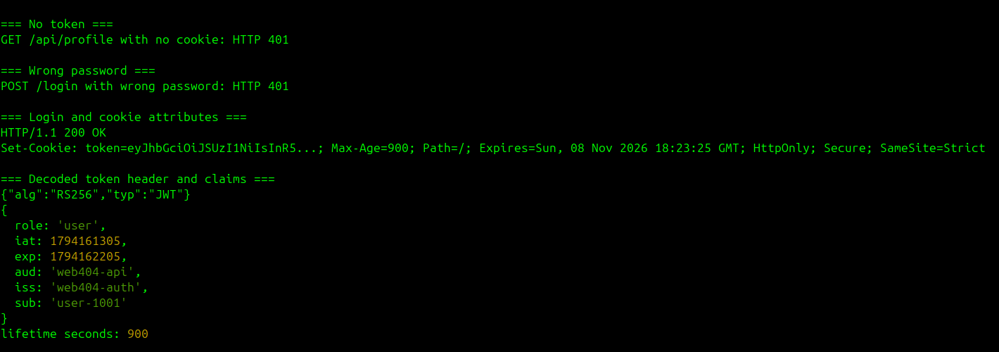
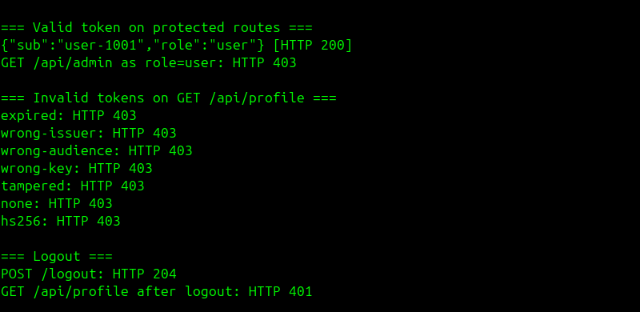
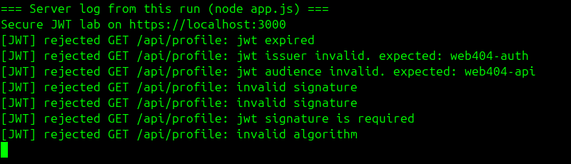

## WEB404 Assignment 5 — Advanced Authentication & Secure JWT Implementation

### Introduction

This report documents a JSON Web Token (JWT) authentication service built with Node.js, Express, and the `jsonwebtoken` library. The service issues short-lived RS256-signed access tokens, stores them in hardened cookies, and verifies the signature, expiry, issuer, audience, and algorithm on every protected route.

The implementation was tested by sending valid tokens and a set of invalid tokens to the running service, then recording how each one was handled.

#### Objectives:

- Design an access token with minimal, non-sensitive claims and a short lifetime.
- Sign tokens with a strong asymmetric algorithm (RS256).
- Restrict verification to an explicit algorithm list to prevent algorithm downgrade attacks.
- Verify the signature, `exp`, `iss`, and `aud` on every protected API route.
- Store tokens in `HttpOnly`, `Secure` cookies instead of `localStorage`.

### Project structure

| File | Purpose |
|---|---|
| `app.js` | Login, token signing, verification middleware, and protected routes |
| `make-token.js` | Builds invalid tokens for local verification tests |
| `demo.sh` | Runs the verification tests against the local service |
| `keys/` | RSA key pair, generated locally and excluded from version control |
| `certs/` | Self-signed HTTPS certificate, generated locally and excluded from version control |

### Setup

```bash
npm install

mkdir -p keys certs
openssl genpkey -algorithm RSA -pkeyopt rsa_keygen_bits:2048 -out keys/private.pem
openssl pkey -in keys/private.pem -pubout -out keys/public.pem
openssl req -x509 -newkey rsa:2048 -nodes -keyout certs/localhost.key -out certs/localhost.crt \
  -days 365 -subj /CN=localhost -addext "subjectAltName=DNS:localhost,IP:127.0.0.1"

node app.js      # first terminal
./demo.sh        # second terminal
```

The demo account is `tashi`. Its password is a lab-only default, which can be overridden with the `DEMO_PASSWORD` environment variable.

## Token architecture

| Claim | Value | Purpose |
|---|---|---|
| `sub` | `user-1001` | An opaque user identifier, not an email or username |
| `role` | `user` | The authorization role |
| `iss` | `web404-auth` | The service that issued the token |
| `aud` | `web404-api` | The API the token is intended for |
| `iat` | Issue time | When the token was created |
| `exp` | `iat` + 900 seconds | A 15-minute expiry |

A JWT payload is encoded, not encrypted, so anyone holding the token can read it. For that reason the token contains no password, email address, or other personal data.

## Implementation

### Signing

RS256 uses the private key to sign and the public key to verify. Only the authentication code needs the private key, and a service that only verifies tokens cannot create them.

```js
function issueToken(user) {
  return jwt.sign({ role: user.role }, PRIVATE_KEY, {
    algorithm: 'RS256',
    subject: user.id,
    issuer: ISSUER,
    audience: AUDIENCE,
    expiresIn: TOKEN_LIFETIME_SECONDS
  });
}
```

### Verification middleware

```js
function authenticateToken(req, res, next) {
  const token = req.cookies.token;
  if (!token) return res.sendStatus(401);

  jwt.verify(token, PUBLIC_KEY, {
    algorithms: ['RS256'],
    issuer: ISSUER,
    audience: AUDIENCE
  }, (err, claims) => {
    if (err) {
      console.warn(`[JWT] rejected ${req.method} ${req.originalUrl}: ${err.message}`);
      return res.sendStatus(403);
    }
    req.user = claims;
    next();
  });
}
```

The `algorithms` list is the key control. The server decides which algorithm is acceptable, and the `alg` value in the token header cannot change that decision.

The sample code in the assignment guide does not set or check `iss` and `aud`, although the instructions require them. This implementation sets both when signing and verifies both on every protected route.

Each protected route applies the middleware directly:

```js
app.get('/api/profile', authenticateToken, (req, res) => {
  res.json({ sub: req.user.sub, role: req.user.role });
});

app.get('/api/admin', authenticateToken, requireRole('admin'), (req, res) => {
  res.json({ message: 'Admin area' });
});
```

### Secure storage

```js
const COOKIE_OPTIONS = {
  httpOnly: true,       // page scripts cannot read the token, which limits XSS theft
  secure: true,         // only sent over HTTPS
  sameSite: 'strict',   // not attached to cross-site requests
  path: '/'
};
```

JavaScript on a page can read `localStorage`, so a single XSS flaw could steal a token stored there. An `HttpOnly` cookie is not available to page scripts. Because browsers attach cookies automatically, `SameSite=Strict` is also used to limit cross-site request forgery.

### Password handling

Passwords are stored only as salted `scrypt` hashes and compared with `crypto.timingSafeEqual`. Unknown usernames still go through a hash and comparison, so response time does not reveal which usernames exist. Both failure cases return the same message.

## Verification

The screenshots in this section are captures of a live run of `demo.sh` in GNOME Terminal against the running service, cropped to remove empty space. The output is also included as text.

### Login and cookie attributes

The login response sets the token with `HttpOnly`, `Secure`, and `SameSite=Strict`. The token value is shortened in the script's output.

```text
=== Login and cookie attributes ===
HTTP/1.1 200 OK
Set-Cookie: token=eyJhbGciOiJSUzI1NiIsInR5...; Max-Age=900; Path=/; Expires=Sun, 08 Nov 2026 18:23:25 GMT; HttpOnly; Secure; SameSite=Strict
```

### Token contents

The decoded token uses RS256, contains only the planned claims, and lasts 900 seconds.

```text
=== Decoded token header and claims ===
{"alg":"RS256","typ":"JWT"}
{
  role: 'user',
  iat: 1794161305,
  exp: 1794162205,
  aud: 'web404-api',
  iss: 'web404-auth',
  sub: 'user-1001'
}
lifetime seconds: 900
```



### Access control

```text
=== No token ===
GET /api/profile with no cookie: HTTP 401

=== Wrong password ===
POST /login with wrong password: HTTP 401

=== Valid token on protected routes ===
{"sub":"user-1001","role":"user"} [HTTP 200]
GET /api/admin as role=user: HTTP 403

=== Logout ===
POST /logout: HTTP 204
GET /api/profile after logout: HTTP 401
```

### Invalid tokens

```text
=== Invalid tokens on GET /api/profile ===
expired: HTTP 403
wrong-issuer: HTTP 403
wrong-audience: HTTP 403
wrong-key: HTTP 403
tampered: HTTP 403
none: HTTP 403
hs256: HTTP 403
```



The server log shows the reason for each rejection:

```text
Secure JWT lab on https://localhost:3000
[JWT] rejected GET /api/profile: jwt expired
[JWT] rejected GET /api/profile: jwt issuer invalid. expected: web404-auth
[JWT] rejected GET /api/profile: jwt audience invalid. expected: web404-api
[JWT] rejected GET /api/profile: invalid signature
[JWT] rejected GET /api/profile: invalid signature
[JWT] rejected GET /api/profile: jwt signature is required
[JWT] rejected GET /api/profile: invalid algorithm
```



## Results

| Test | Expected | Result | Rejected because |
|---|---|---|---|
| No cookie | Rejected | 401 | No token supplied |
| Wrong password | Rejected | 401 | Invalid credentials |
| Valid token, `/api/profile` | Accepted | 200 | Not applicable |
| `role=user`, `/api/admin` | Rejected | 403 | Role check |
| Expired token | Rejected | 403 | `exp` is in the past |
| Wrong issuer | Rejected | 403 | `iss` does not match |
| Wrong audience | Rejected | 403 | `aud` does not match |
| Signed with a different key | Rejected | 403 | Invalid signature |
| Payload changed after signing | Rejected | 403 | Invalid signature |
| `alg: none`, unsigned | Rejected | 403 | Signature required |
| HS256 token keyed with the public key | Rejected | 403 | Algorithm not allowed |
| After logout | Rejected | 401 | Cookie cleared |

## Token security best practices

- **Fix the algorithm on the server.** Always pass an explicit `algorithms` list when verifying, and never trust the token's `alg` header.
- **Prefer asymmetric signing.** With RS256, services that verify tokens hold only the public key. If HS256 is used, the secret must be long and randomly generated.
- **Protect the private key.** Keep it out of source control and load it from a secrets manager or protected file. Rotate keys periodically.
- **Keep access tokens short-lived.** A 15-minute expiry limits how long a stolen token is useful.
- **Validate every claim that matters.** Check the signature, `exp`, `iss`, and `aud` on every protected route.
- **Keep payloads minimal.** Payloads are readable by anyone holding the token, so they should never contain secrets or personal data.
- **Store tokens in hardened cookies.** Use `HttpOnly` and `Secure`, avoid `localStorage`, and pair cookies with `SameSite` or CSRF tokens.
- **Use HTTPS everywhere.** A token sent over plain HTTP can be intercepted and replayed.
- **Plan for revocation.** See the limitations below.

## Limitations

Logout clears the browser's cookie, but a stateless JWT remains valid until it expires, so a copy taken earlier would still work for up to 15 minutes. A production system would add a server-side deny list keyed by a `jti` claim, or rotating refresh tokens stored server-side. Refresh tokens are outside the scope of this lab. The single in-memory user and the self-signed certificate are also lab fixtures only.

## Conclusion

The service issues minimal RS256 access tokens with a 15-minute lifetime and stores them in `HttpOnly`, `Secure`, `SameSite=Strict` cookies. Its middleware verifies the signature, algorithm, expiry, issuer, and audience on every protected route. In testing, valid tokens were accepted, and expired, altered, wrongly signed, unsigned, and algorithm-swapped tokens were all rejected. The main remaining limitation is that a stateless token cannot be revoked before it expires, which the short lifetime reduces but does not remove.
